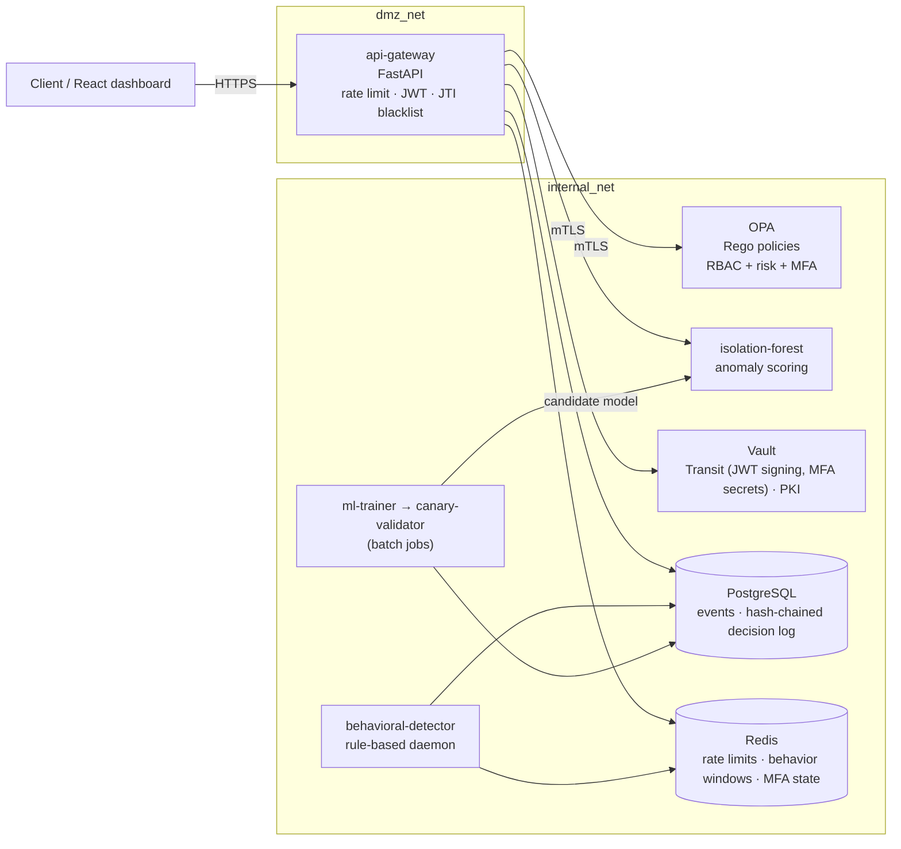
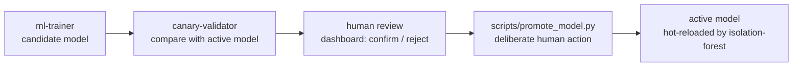

# ARGUS — Zero Trust API Gateway

**An API gateway where no request reaches a resource on the strength of a valid token alone: every
request is authenticated, scored by an anomaly-detection model, authorized by a policy engine, and
recorded in a tamper-evident audit log.**

Built during my internship at **Pwn & Patch** ([À COMPLÉTER : dates du stage]). Portfolio / demo
project, not a production deployment: known limitations are listed below, not hidden.

---

## The problem

Classic perimeter security trusts any request that carries a valid session. A stolen password, a
replayed token or a compromised internal service is then enough to read or delete data. ARGUS applies
Zero Trust principles at the API layer: trust is re-evaluated on **every** request, from identity,
role, recent behavior and the sensitivity of the action.

## How it works

Three **independent** decision layers must all pass:

1. **RBAC** (`policies/authz/rbac.rego`): role → allowed action. `reader` reads, `editor`/`admin`
   write, only `admin` deletes or touches `/users`.
2. **ML risk score** (Isolation Forest): recent behavior compared with a calibrated threshold.
   Absent at bootstrap, when no model has been promoted yet.
3. **Adaptive rules** (`policies/risk/adaptive_access.rego`): distinct IPs, resource enumeration and
   sensitive actions (`delete`, `/users`) trigger a step-up MFA or a deny **even without an ML
   score**, by design.

OPA combines the three, and each decision is written to `opa_decision_log`, chained with SHA-256
(`scripts/verify_audit_integrity.py` verifies the chain, read-only).

## Architecture



Request pipeline in the gateway: IP rate limit → JWT verification (Ed25519, signed by Vault Transit)
→ per-user rate limit → JTI blacklist → feature vector → Isolation Forest score → OPA decision →
business handler → audit.

### Components

| Component | Type | Role |
|---|---|---|
| `api-gateway` | REST API (FastAPI, `/docs`) | Only public entry point: authentication, scoring, authorization, audit |
| `policies/` | OPA/Rego bundle | RBAC + adaptive rules + MFA, combined in `authz/decision.rego` |
| `isolation-forest` | Internal REST (mTLS) | `/score`, `/health`. Never published on the host, unreachable without a client certificate |
| `ml-trainer` | Batch job | Trains a candidate model, then exits |
| `canary-validator` | Batch job | Compares a candidate with the production model on real traffic, then exits |
| `behavioral-detector` | Daemon (no HTTP) | Rule-based detection on the same Redis windows as the ML score |
| `dashboard` | React SPA | Monitoring, anomalies, audit log, canary review. Talks only to the gateway |
| `tools/traffic-generator` | Simulator | Realistic personas plus four attack scenarios (see Results) |

### ML model lifecycle



`promote_model.py` refuses a candidate with no computed score distribution, with feature dimensions
that no longer match the current vector, or that a human explicitly **rejected** during canary review.

## Tech stack

| Area | Technologies |
|---|---|
| Gateway | Python 3.11, FastAPI, SQLAlchemy (async), Alembic, Pydantic |
| Policy | Open Policy Agent 1.18, Rego |
| Machine learning | scikit-learn (Isolation Forest), NumPy |
| Secrets & PKI | HashiCorp Vault 1.20 (Transit, PKI), mTLS |
| Data | PostgreSQL 15, Redis 7 |
| Authentication | Ed25519 JWT, rotating refresh tokens, TOTP MFA, Argon2id |
| Frontend | React 18, TypeScript, Vite |
| Infrastructure | Docker Compose, segmented networks (`dmz_net` / `internal_net`) |

## Screenshots

| Dashboard | Anomalies panel | Audit log |
|---|---|---|
| [À COMPLÉTER : `docs/screenshots/dashboard.png`] | [À COMPLÉTER : `docs/screenshots/anomalies.png`] | [À COMPLÉTER : `docs/screenshots/audit-log.png`] |

## Getting started

Requirements: Docker Desktop (Compose v2).

```bash
docker compose -f docker/docker-compose.yml up -d
docker compose -f docker/docker-compose.yml ps
```

`postgres`, `redis`, `vault`, `opa`, `isolation-forest` and `behavioral-detector` should report
`(healthy)`. `api-gateway` and `dashboard` have no healthcheck, so `Up` is enough for them.

| Service | Local URL | Notes |
|---|---|---|
| `api-gateway` | http://localhost:8000 | Swagger: `/docs` · ReDoc: `/redoc` |
| `dashboard` | http://localhost:5173 | demo account below |
| `postgres` | localhost:5433 | user `postgres`, database `zt_db` |
| `redis` | localhost:6379 | `-a redis-dev-password` |
| `vault` | http://localhost:8200 | dev mode, token `dev-root-token` |
| `opa`, `isolation-forest` | internal only | mTLS, never published on the host |

All credentials above are **local demo defaults**, documented on purpose. Never reuse them outside a
local lab.

Stop with `docker compose -f docker/docker-compose.yml down` (volumes survive; add `-v` to wipe
everything, database included).

### Demo accounts

Shared password `ChangeMe123!` (override with `SEED_USER_PASSWORD`). Roles: `reader1..15`,
`editor1..8`, `admin1..2`, all `@zt.local`. TOTP secrets are written to
`tools/traffic-generator/persona_secrets.json`, which is gitignored and generated by `seed_users.py` /
`seed_business_data.py`.

### Operational scripts

Run them inside the running container:

```bash
docker exec zt-api poetry run python scripts/verify_audit_integrity.py   # read-only
docker exec zt-api poetry run python scripts/promote_model.py <version>  # deliberate human action
docker exec zt-api poetry run python scripts/seed_users.py               # accounts + MFA secrets
docker exec zt-api poetry run python scripts/seed_business_data.py       # documents/orders + personas
```

### Tests

```bash
cd services/api-gateway && poetry install && poetry run pytest
opa test policies/ -v
```

Other services (`isolation-forest`, `ml-trainer`, `canary-validator`, `behavioral-detector`,
`tools/traffic-generator`) each have their own `poetry run pytest`. Dashboard: `npm test` in
`services/dashboard`.

## Security design choices

| Control | Threat addressed |
|---|---|
| Three independent layers (RBAC, ML score, adaptive rules) | A valid token alone is never enough |
| Step-up MFA on sensitive actions, independent of the ML score | A stolen password alone cannot delete data or create an admin |
| Strict CORS allow-list, never `*` | Cross-origin session theft |
| Refresh token in an httpOnly, rotating, single-use cookie | XSS cannot read it; a replayed token revokes the whole session family |
| JTI blacklist | Reuse of a revoked access token |
| JWTs signed by Vault Transit (the key never leaves Vault) | Signing-key theft from the gateway |
| mTLS Gateway↔OPA and Gateway↔Isolation Forest | A compromised internal peer spoofing OPA or faking the risk score |
| Redis authentication (`requirepass`) | A compromised container forging MFA state directly in Redis |
| SHA-256 hash chain on `opa_decision_log` | Silent tampering with the audit log |
| Account-existence oracle closed on the login lockout path | User enumeration |
| HTTP security headers (CSP, conditional HSTS…) | Clickjacking, MIME sniffing |
| Network segmentation `dmz_net` / `internal_net` | Direct access to internal services |
| Human-in-the-loop model promotion | Poisoned or degraded model reaching production automatically |

### Known limitations (accepted for a demo)

- Vault runs in dev mode (in memory, regenerated on every `docker compose up`).
- Gateway↔{Vault, PostgreSQL, Redis} traffic is plain text on the private Docker network; mTLS only
  covers Gateway↔OPA and Gateway↔Isolation Forest.
- Redis uses one password shared by the connected services, not per-service ACLs.
- Only `opa_decision_log` is hash-chained; `events` (authentication failures, rate limits) is not.
- No CI yet, so no automated dependency scanning or SAST.

## Results

- **Automated tests**, at the commit this README was written on:
  - `api-gateway`: **276 passing tests**, 15 skipped (`pytest`).
  - OPA/Rego policies: **128/128 passing tests** (`opa test policies/`).
- **Attack simulation:** `tools/traffic-generator` replays four scenarios against the gateway
  alongside normal personas: **A** resource enumeration, **B** password spraying, **C** session
  hijacking, **D** privilege escalation. The raw logs of a recorded run are in
  `tools/traffic-generator/attack_*.log`.
- [À COMPLÉTER : résultats de détection par scénario, par exemple le nombre de requêtes bloquées ou
  passées en step-up MFA, et le délai de détection, mesurés sur vos propres runs]

## Next steps

- [À COMPLÉTER : priorités prévues]
- Possible directions taken from the known limitations: a CI pipeline with dependency scanning and
  SAST, mTLS on the remaining internal links, per-service Redis ACLs, hash-chaining the `events` table,
  and Vault in server mode.
